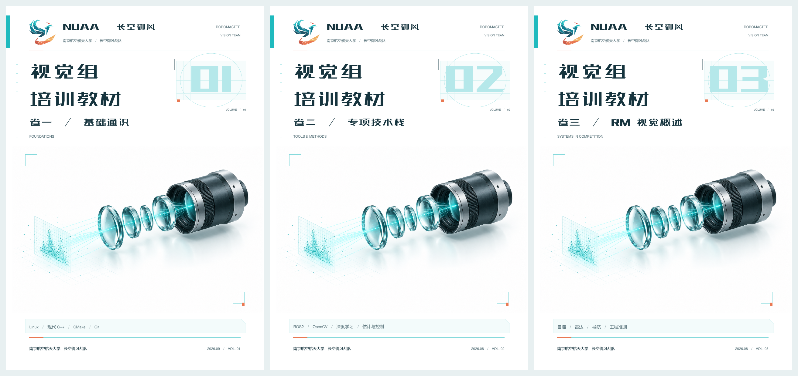

# 长空御风视觉组培训教材

这是南航长空御风战队视觉组的新人培训教材。我们从装好系统、写出第一个 C++ 工程开始，再逐步走到自瞄、雷达和导航的比赛链路。希望你读完一节后能动手做出来，遇到问题时也知道该看哪里、怎样确认自己的判断。

教材分为三卷独立的 LaTeX 工程，使用 ElegantBook 模板和 XeLaTeX 排版。正文、随书小项目、练习题解和修订记录都放在这个仓库里。



**快速入口：** [三卷内容](#三卷内容) · [怎样开始学习](#怎样开始学习) · [编译 PDF](#编译-pdf) · [随书示例](#随书示例) · [当前进度](#当前进度) · [后续 TODO](#后续-todo) · [参与维护](#参与维护)

## 三卷内容

| 卷册 | 主要解决的问题 | 编译入口 | 随书项目 |
| --- | --- | --- | --- |
| **卷一 · 基础通识** | 怎样配置环境、写 C++、构建和调试工程 | [main.tex](01-基础通识/main.tex) | [examples](01-基础通识/examples/) |
| **卷二 · 专项技术栈** | 怎样实现视觉系统中的各个技术模块 | [main.tex](02-专项技术栈/main.tex) | [examples](02-专项技术栈/examples/) |
| **卷三 · RM 视觉概述** | 怎样把模块串成比赛链路，并与其他组协作 | [main.tex](03-RM视觉概述/main.tex) | [examples](03-RM视觉概述/examples/) |

### 卷一 · 基础通识（3 章）

1. **Linux 工作环境**：Ubuntu 双系统、文件与权限、Shell、Git、CLion / VS Code、串口基础，以及备份、Conda、桌面美化等选修内容。
2. **现代 C++ 基础**：类、引用与移动、lambda、智能指针、STL 和多线程。
3. **编译过程与 CMake 基础**：从源码到程序，组织多文件工程、库、依赖和安装规则。

卷一面向所有方向。标 `*` 的小节为选修，不计入通识考核；刚入门时先把核心工程跑通，美化和进阶维护可以等用到时再回来查。

### 卷二 · 专项技术栈（11 章）

| 章 | 内容 | 正文入口 |
| --- | --- | --- |
| 1 | ROS2 基础：节点、接口、Launch、构建、IDE 调试与排障 | [A_ros2.tex](02-专项技术栈/chapters/A_ros2.tex) |
| 2 | 多机通信方法：TCP、串口帧、CRC、重连和状态时效 | [J_comm.tex](02-专项技术栈/chapters/J_comm.tex) |
| 3 | SDR 与电磁波解析：IQ、同步、解调和接收流水线 | [K_sdr.tex](02-专项技术栈/chapters/K_sdr.tex) |
| 4 | OpenCV 与图像处理基础：图像、颜色、滤波、轮廓和 ROS 图像桥接 | [B_opencv.tex](02-专项技术栈/chapters/B_opencv.tex) |
| 5 | 神经网络与深度学习：训练、保存、独立推理和部署入口 | [C_dl.tex](02-专项技术栈/chapters/C_dl.tex) |
| 6 | CUDA 与 GPU 加速：Host / Device、kernel、传输和性能测量 | [D_cuda.tex](02-专项技术栈/chapters/D_cuda.tex) |
| 7 | 相机与成像原理：曝光、噪声、同步和标定 | [E_camera.tex](02-专项技术栈/chapters/E_camera.tex) |
| 8 | 信号处理与滤波：低通、Kalman、EKF 和 UKF | [F_filter.tex](02-专项技术栈/chapters/F_filter.tex) |
| 9 | 几何视觉与 Bundle Adjustment：投影、PnP、BA 和几何实验 | [G_ba.tex](02-专项技术栈/chapters/G_ba.tex) |
| 10 | 模型预测控制：系统模型、约束、QP 和滚动时域 | [H_mpc.tex](02-专项技术栈/chapters/H_mpc.tex) |
| 11 | 导航与 SLAM 初步：地图、TF、定位、Nav2 和恢复流程 | [I_nav.tex](02-专项技术栈/chapters/I_nav.tex) |

有些章节拆成多个 `.tex` 文件，上表给出讲解入口，完整顺序以本卷 `main.tex` 为准。

### 卷三 · RM 视觉概述（7 章）

1. 视觉组在 RM 中的职责与技术全景
2. 自瞄系统概述
3. 导航在 RM 中的应用
4. 雷达站与全场感知概述
5. 相机与前端的赛场实践要点
6. 工程准则与调车文化
7. 进阶地图与资料索引

这一卷重在画清数据流、说明接口、定位问题和安排验证。需要推公式或写实现时，再回到卷二的对应章节。

## 怎样开始学习

首先通读卷三第 1 章，看看视觉组做什么；再结合第 2、6 章认识自瞄链路和调车习惯。接下来完成卷一的核心内容与章末验收，有了 Linux、C++ 和 CMake 基础后，再按方向学习卷二。

| 方向 | 卷二建议路线 | 卷三重点 |
| --- | --- | --- |
| 自瞄 | ROS2 → OpenCV → 深度学习 → 相机 → 滤波 → 几何视觉 / BA → MPC；CUDA 按需补充 | 第 2、5、6 章 |
| 雷达 | ROS2 → 多机通信 → SDR → OpenCV → 深度学习 → 相机；CUDA、滤波按需补充 | 第 4、5、6 章 |
| 导航 | ROS2 → 导航与 SLAM；相机、滤波、多机通信按任务补充 | 第 3、6 章 |

组内方向是**自瞄、雷达、导航**。OpenCV、深度学习和 CUDA 是共用技能；导航里的激光雷达（LiDAR）是测距传感器，雷达方向则指高台全场感知站，交流时要把这两个含义说清楚。

读一章时，建议先看章首目标，再跟着示例操作，随后独立做随堂练习和章末题。各卷末尾有参考题解，卡住时可以用来核对思路。章末验收要求你拿出程序、操作结果或记录；进入方向工程后，还需要补上真实设备与跨组联调。

## 编译 PDF

### 准备环境

安装 **XeLaTeX** 和完整的 TeX Live（macOS 可用 MacTeX），包含中文排版所需的 `ctex`、字体，以及 TikZ、tcolorbox、listings 等宏包。只阅读或编译教材时，不需要安装 ROS、CUDA 或相机 SDK；这些依赖在运行相应示例时再准备。

封面使用仓库内的 [站酷高端黑字体](fonts/站酷高端黑.ttf)，无需单独装到系统中。正文使用模板的 `chinesefont=ctexfont` 配置，由 ctex 选择字体集。下载仓库时请保留 `templates/`、`fonts/` 和 `assets/`，不要只拷贝某一卷。

### 编译一卷

在仓库根目录打开终端，进入要编译的卷目录：

```bash
cd '01-基础通识'  # 也可以换成 02-专项技术栈 或 03-RM视觉概述
xelatex -interaction=nonstopmode -halt-on-error main.tex
xelatex -interaction=nonstopmode -halt-on-error main.tex
```

输出是该卷目录下的 `main.pdf`。至少编译两次，让目录、图表编号和交叉引用更新；日志仍提示需要重跑时，继续编译直到引用稳定。

如果装了 latexmk，也可以在卷目录下运行：

```bash
latexmk -xelatex -interaction=nonstopmode -halt-on-error main.tex
```

根目录的 `main.tex` 是旧合订本的提示入口。三卷分别编译，各卷的 PDF 和 LaTeX 中间文件按 [.gitignore](.gitignore) 的规则保留在本地。

| 遇到的问题 | 先检查什么 |
| --- | --- |
| 找不到宏包、字体或 `.cls` | TeX 环境是否完整，仓库的共享模板和字体是否保留；先处理日志中的第一个错误 |
| 找不到图片或相对路径 | 是否在对应卷目录编译，图片是否位于本卷 `images/` 或正文指定的位置 |
| 卷二、卷三找不到 ElegantBook | 本卷 `elegantbook.cls` 是指向共享模板的符号链接，检查下载或复制时是否保留链接 |
| 目录或引用显示旧内容 / `??` | 确认本次编译成功，再重新编译；仍未消除时检查标签和引用 |

## 随书示例

每卷的 `examples/` 保存可运行的小工程。先读对应目录的 README，确认依赖、工作目录、命令和预期结果，再复制到自己的练习目录中修改。不同示例的依赖各不相同，按当前章节安装即可。

| 想练习什么 | 可以从这里开始 |
| --- | --- |
| C++ 构建、库与安装 | [build-pipeline-demo](01-基础通识/examples/build-pipeline-demo/README.md) |
| ROS2 节点、接口、Launch 与工程排障 | [ROS2 工程实践](02-专项技术栈/examples/ros2/README.md) |
| OpenCV 图像处理和中间结果观察 | [image-lab-demo](02-专项技术栈/examples/opencv/image-lab-demo/README.md) |
| 从训练到独立推理 | [lenet-training-demo](02-专项技术栈/examples/dl/lenet-training-demo/README.md) |
| 地图、TF、Nav2 与恢复 | [navigation-lab-demo](02-专项技术栈/examples/navigation/navigation-lab-demo/README.md) |
| 接口中的单位、坐标和时间约定 | [interface-card-demo](03-RM视觉概述/examples/interface-card-demo/README.md) |

**当前卷二的主要验证环境是 Distrobox `ubuntu2404` 中的 Ubuntu 24.04.5 / ROS 2 Jazzy。** 使用这个环境时，先进入容器，再按示例 README 加载 ROS 环境、安装依赖和构建。卷一双系统安装教程仍以 Ubuntu 22.04 为例；卷二涉及 Humble / Jazzy 差异时按正文分别处理，Jazzy 的运行记录不能代替 Humble 实测。

教学数据、软件回环和离线回放用于把概念跑清楚。相机读回、板端协议、跨物理主机通信和实车动作，仍需在对应设备上完成章末验收。

## 仓库结构

```text
Tutorial4New/
├── README.md
├── main.tex                     # 三卷编译入口的提示页
├── 01-基础通识/
│   ├── main.tex                 # 卷一入口
│   ├── Chapter1/、Chapter2/、Chapter3/
│   ├── examples/                # 随书工程
│   ├── images/                  # 正文插图
│   └── answers.tex              # 参考题解
├── 02-专项技术栈/
│   ├── main.tex
│   ├── chapters/
│   ├── examples/
│   ├── images/
│   └── answers.tex
├── 03-RM视觉概述/
│   ├── main.tex
│   ├── chapters/
│   ├── examples/
│   ├── images/
│   └── answers.tex
├── templates/                   # 共用类文件、导言和封面
├── fonts/                       # 项目字体
├── assets/covers/               # 封面插画、预览与复用说明
├── docs/revision/               # 全书及逐章修订记录、运行证据
└── .agents/skills/textbook-chapter/
    └── SKILL.md                 # 章节编写与验收规范
```

共用导言在 [preamble.tex](templates/preamble.tex)，封面和学习导览在 [cover.tex](templates/cover.tex)，各卷通过 `\TextbookVolume{1/2/3}` 选择内容。封面素材与单独导出方式见 [封面说明](assets/covers/README.md)。旧合订本 `_legacy/` 和大附件 `参考文献/` 是本地归档，不随仓库提交。

## 当前进度

以下是 **2026-09-29 已记录的修订与验收状态**，后续以 [全书验收汇总](docs/revision/whole-book-audit.md) 和其中的逐章记录为准。

三卷 **21 章已完成首次逐章整理并分别提交**，补齐了章首提要、示例、练习、难点小结、章末习题、验收和参考题解。已记录 234 道随堂练习、187 道章末习题，并完成现有环境中的软件补测和 PDF 检查。

| 卷册 | 章节数 | 检查通过 | 未完成 | 不适用 |
| --- | --- | --- | --- | --- |
| 卷一 | 3 | 59 | 1 | 0 |
| 卷二 | 11 | 215 | 5 | 0 |
| 卷三 | 7 | 133 | 5 | 2 |
| **合计** | **21** | **407** | **11** | **2** |

每章按规范检查 20 项，共 420 项；两项不适用来自卷三第 7 章没有图片。**全书尚未通过全部验收**，剩余缺口主要是实机、真实队内资料和他人复核，具体工作列在下面的 TODO 中。

需要追溯某章的改动和验证时，可查看 [逐章修订进度](docs/revision/progress.md)、[完整检查矩阵](docs/revision/evidence/whole-book-checklist.json) 和 [运行证据目录](docs/revision/evidence/)。

## 后续 TODO

### 优先处理：安装图片换成截图

- [ ] **把安装教程中的拍屏照片替换为真实截图。** 从卷一 [Ubuntu 安装教程](01-基础通识/Chapter1/11.tex) 开始，逐张检查分区、启动盘制作、安装器和系统设置等步骤的配图，再排查其他安装小节。

完成时需要确认：截图对应正文使用的软件版本和操作步骤，关键按钮、分区信息与提示文字能在 PDF 中读清；统一裁剪范围和图注，保留真实界面内容。如果用虚拟机演示安装界面，在图注中说明环境，实机安装验收另行记录。涉及终端的截图使用 **Maple Mono NF CN**，检查中文和 Nerd Font 图标，避免出现白色方框。

新图放入对应卷的 `images/`，同步正文引用。按章节规范实际查看图片和 PDF 后，再使用 `_revised` 标记；相关章节编译通过并补上图片变更记录后，单独提交。

### 补齐现有验收缺口

- [ ] **补齐全书汇总中的 11 项未完成检查。** 下表按章节列出需要补做的工作；一项检查可能包含多个实验，完成条件以对应章的原有验收和修订记录为准。

| 对应章节 | 下一步需要完成的工作 | 验收记录 |
| --- | --- | --- |
| 卷一 / 1 · Linux | Windows + UEFI 双系统写盘、安装、两套系统启动与恢复；桌面 / 登录切换、Windows IDE 工具链和物理串口验证 | [记录](docs/revision/volume-1-chapter-1.md) |
| 卷二 / 1 · ROS2 | 在第二台物理主机上验证发现范围、通信及故障后的恢复 | [记录](docs/revision/volume-2-chapter-1.md) |
| 卷二 / 2 · 多机通信 | 接入实际板端 USB / 串口，完成跨物理主机的协议收发与异常测试 | [记录](docs/revision/volume-2-chapter-2.md) |
| 卷二 / 3 · SDR | 接入 Pluto，验证实际射频接收链路并保留采集数据 | [记录](docs/revision/volume-2-chapter-3.md) |
| 卷二 / 4 · OpenCV | 用实际相机采集，核对设备参数读回和图像结果 | [记录](docs/revision/volume-2-chapter-4.md) |
| 卷二 / 7 · 相机 | 验证曝光、HDR、同步和厂商 SDK，完成实机标定并保留数据 | [记录](docs/revision/volume-2-chapter-7.md) |
| 卷三 / 3 · 导航 | 使用真实赛场地图、机器人和激光雷达，核对定位、动态环境下的制动与恢复空间 | [记录](docs/revision/volume-3-chapter-3.md) |
| 卷三 / 4 · 雷达 | 补高位相机、现场地形与标定、适用版本协议和射频数据的验证 | [记录](docs/revision/volume-3-chapter-4.md) |
| 卷三 / 5 · 前端 | 验证 SDK 参数读回、设置恢复、实际曝光和端到端时序 | [记录](docs/revision/volume-3-chapter-5.md) |
| 卷三 / 6 · 工程准则 | 由另一人按实验记录复核关键证据，并核对真实队内经验 | [记录](docs/revision/volume-3-chapter-6.md) |
| 卷三 / 7 · 资料索引 | 接入真实队内录像、协议和归档，补责任人、版本与同学复核 | [记录](docs/revision/volume-3-chapter-7.md) |

每次补测都记录环境、版本、命令或操作、实际结果和结论。缺少设备或资料的部分继续保留为“未完成”；完成后同步逐章记录、检查矩阵和全书汇总，再提交对应章节的改动。

### 后续维护

- [ ] **继续检查语言风格。** 以卷一原有 `11.tex`、`12.tex`、`13.tex` 的连贯讲解为参照，保留“你 / 我们”、自然过渡和随操作解释原因的写法。后续补充示例、题解或截图说明时，也按这个尺度检查。
- [ ] **维护版本说明与复现入口。** 更新 ROS、IDE、CUDA 或 SDK 相关内容时，先在所声明的环境实跑，再同步正文、示例 README 和验证记录；其他发行版的实测结果单独记录。
- [ ] **在验收补齐后重新核对三卷发布内容。** 编译至引用稳定，查看受影响页面，检查图片清晰度、题号 / 题解和跨卷指引；同步本页进度与封面版本信息。

## 参与维护

章节写作与验收统一参考 [textbook-chapter / SKILL.md](.agents/skills/textbook-chapter/SKILL.md)。维护时按卷、按章推进，每章整理完成后单独 commit，便于复核和回退。

1. **先确定学习目标。** 面向初学者说明本节解决什么问题，再写讲解、完整示例、练习与结果判断；复杂概念配随书小项目，核心代码和配置在正文中讲清楚。
2. **同步题解和引用。** 修改题目时同时更新本卷 `answers.tex`；调整文件、标签或图片时检查所有引用。
3. **实际运行和查看。** 按正文命令构建、运行示例，覆盖关键成功与失败情形；涉及 GUI 的教程实际操作界面，涉及配图的改动查看图片及最终 PDF。
4. **留下可核对的记录。** 在 `docs/revision/` 写明变更、验证依据和仍有的缺口，按规范逐项记录“通过 / 不适用 / 未完成”。
5. **提交必要的源文件。** 提交正文、题解、小项目、图片和修订记录；PDF、中间文件、个人 IDE 配置、数据集和权重按忽略规则保留在本地。

修改共享模板会影响三卷，需要分别编译检查。提交说明写清改动的卷、章和主要目的，方便下一位维护者接着做。
